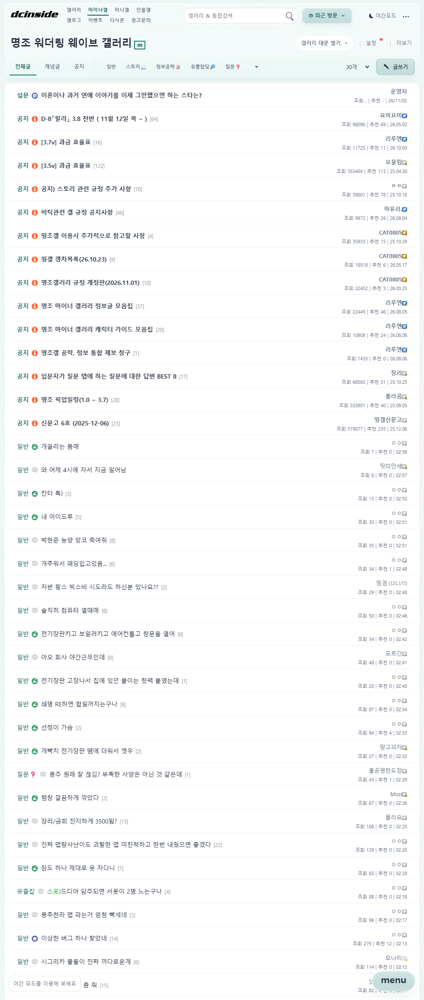
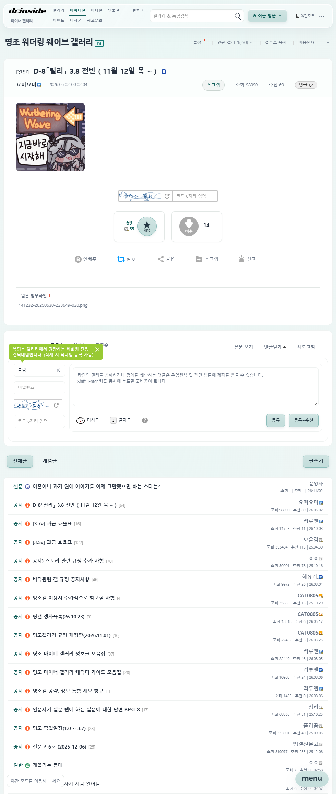
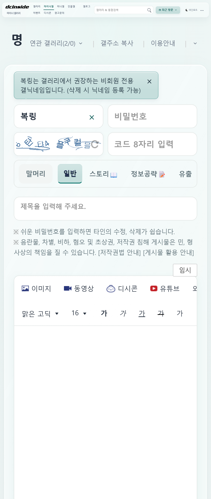
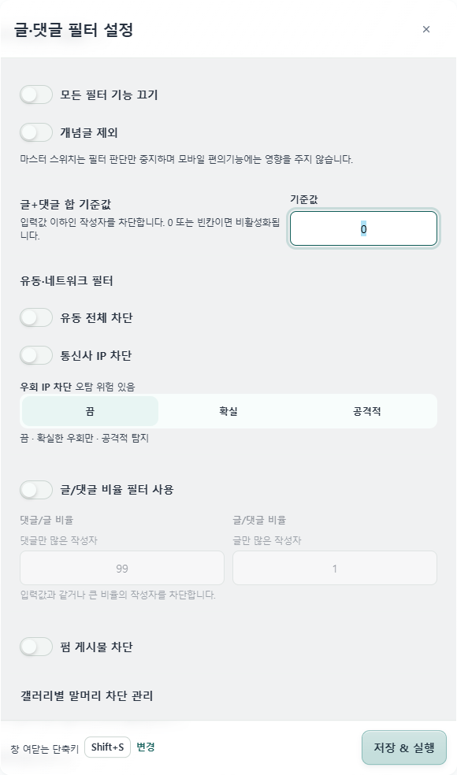
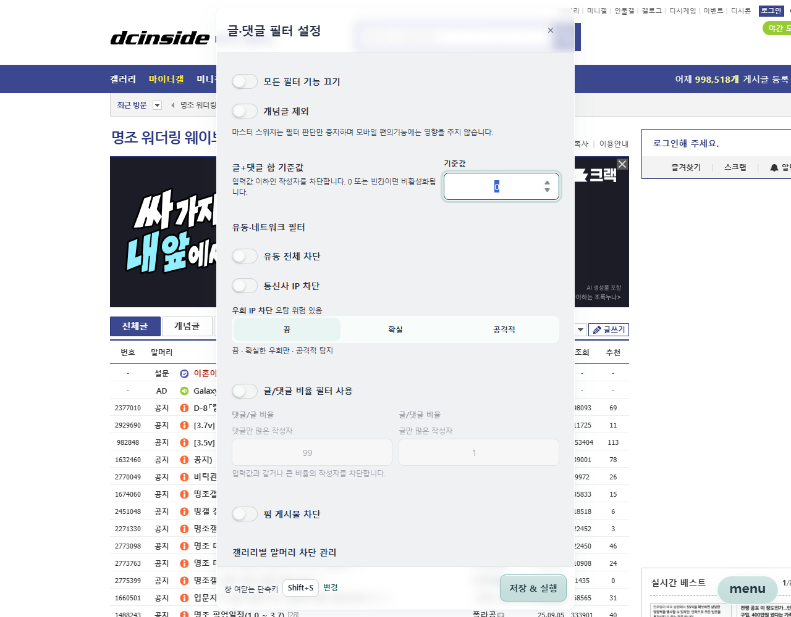
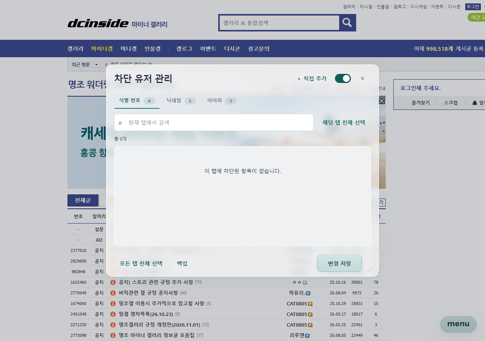

# DCInside User Filter

활동량·글댓비·IP 필터와 개인 차단으로 보고 싶은 글을 더 편하게 읽는 사용자 스크립트입니다.

**최신 버전: 모바일 3.5.7 · PC 2.0.0**

[모바일 3.5.7 패치 노트](https://github.com/domato153/dc-uidfiltering/releases/tag/mobile-v3.5.7)

## 설치

| 모바일 | PC |
| --- | --- |
| 확장 프로그램을 지원하는 브라우저의 **데스크톱 사이트 모드**에서 사용 | 원래 사이트 디자인을 유지하고 필터와 자체 메뉴만 사용 |
| [모바일 스크립트 설치](https://github.com/domato153/dc-uidfiltering/raw/refs/heads/Mobile/Dc_UserFilter_Mobile.user.js) | [PC 스크립트 설치](https://github.com/domato153/dc-uidfiltering/raw/refs/heads/main/dcinside_user_filter.user.js) |

1. [Tampermonkey](https://www.tampermonkey.net/)를 설치합니다.
2. 브라우저에서 사용자 스크립트 실행을 허용합니다. 모바일에서는 디시인사이드를 데스크톱 사이트 모드로 엽니다.
3. 원하는 스크립트를 하나 설치하고 페이지를 새로고침합니다. 같은 페이지에서 모바일·PC 버전을 동시에 켜지 마세요.

설치창 대신 코드가 나오면 Tampermonkey의 도구 → Import from URL에 설치 주소를 넣으세요.

## 주요 기능

- **활동량·글댓비 필터:** 작성자의 활동량과 글/댓글 비율을 기준으로 걸러냅니다.
- **IP 필터:** 통신사·우회 IP 관련 차단을 조절합니다. 공격적 차단은 오탐 가능성이 있습니다.
- **개인 차단:** 닉네임·식별 코드·IP와 갤러리별 말머리를 관리합니다.
- **백업·복원:** 차단 목록을 파일이나 클립보드로 옮깁니다.
- **14가지 UI 색상:** 적용 전에 미리 보고 저장하거나 취소합니다. PC에서는 스크립트 자체 UI에 적용됩니다.

설정과 목록은 각 Tampermonkey 스크립트에 따로 저장됩니다. 모바일·PC·다른 브라우저·기기 사이에 자동 동기화되지 않습니다.

## 실제 화면

익명 공개 갤러리에서 촬영한 실제 화면입니다. 모바일은 휴대폰 세로 화면으로, PC는 원래 사이트 화면 위의 필터 설정으로 보여줍니다.

### 모바일 · 글 목록

### 모바일 · 본문과 글쓰기

### 핵심 기능 · 글댓합 필터 설정

모바일에서는 휴대폰 세로 화면으로, PC에서는 원래 사이트 위에 열린 설정창으로 보여줍니다.

### PC · 차단 유저 관리

PC의 원래 목록·본문·글쓰기 구조는 유지됩니다.

## 문제 제보

[GitHub Issues](https://github.com/domato153/dc-uidfiltering/issues)에 사용 버전, 브라우저, 문제가 생긴 주소와 재현 순서를 알려주세요. 비밀번호·개인 설정·비공개 정보는 포함하지 마세요.

디시인사이드 비공식 사용자 스크립트입니다.
