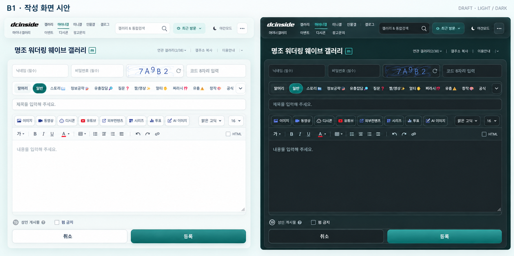

# B1 writer — current-theme adapted proposal

Status: **SUPERSEDED V2 / MATERIAL NEEDS_WORK**. Current proposal: [writer v3](b1-writer-material-v3-2026-10-26.md), pending user selection. This is a newly generated design, not an implementation screenshot or accepted replacement. Product CE3 writer material remains NEEDS_WORK. The user requested this refresh after identifying the early B1 writer panel as too initial/different.

## Reference roles

| Input | Role and identity |
| --- | --- |
| Current adopted compact header | Primary material, typography, spacing and button-language authority. Curated light masthead: [image](b1-current-header-2026-10-25.png), SHA-256 `66C67E354401DD0719FDB1CBEC2409DBA09E9225F93551B674618971C8485248`. Selected region y12–80 only; native title/hint below is contextual, not a new design target. |
| Current dark header | Companion [image](b1-current-header-dark-2026-10-25.png), SHA-256 `A02AE414FE1F812AC19D5279D9F62F5709074A6914A7B4A98377F57F75640B09`. Source-theme proxy; not actual phone/native dark qualification. |
| Native original write page | Real controls, structure and popup triggers. Public GET/HEAD capture2026-10-25 at1280×1300; no userscript. |
| Published stable userscript | Functional/structure control at980×1100, source32BA208DDD9973A7EEC343F01E963A833AB4F0C084987077EDAE46844383C25D. Its old header/blue styles are not the selected visual system. |
| Early B1 board | Historical family direction only. Its writer arrangement no longer overrides the current adopted theme and observed native UI. |

Native URL: https://gall.dcinside.com/mgallery/board/write/?id=wutheringwaves . Current source CE3C4D1B09A52408F0F10C96FB0B4362AE74E3AC8000C9149DE83A9E76A30EDD, captures980×1100. Values were cleared only in isolated public capture contexts; no submit, upload, authentication or POST. Raw source screenshots and capture inventory remain local in artifacts/b1-write-refresh-2026-10-25/. The curated header crops contain no account/input data.980×1100 is a detail view, not full measured-phone qualification.

## New proposal

SHA-256 `2E63A533A5A2965C25954BE949FABC077037725758E0730299CFE2633379F381`. Generated2026-10-25 using built-in image_gen with current-light/current-dark/native/published screenshots in that explicit order. Exact [generation prompt](b1-write-current-theme-2026-10-25.prompt.txt) retained. Both panels use the current compact masthead and extend its restrained pearl/smoky glass into form chrome/toolbars. Reading/editing paper stays calm and legible; teal primary action and quiet secondary controls use the same family.

Visual inspection: native category/title/editor/options/action order and the two levels of media/formatting tools are represented; no list tabs, sidebar, invented save button or upload box. Native hints/warnings/conditional controls still belong to implementation even when not depicted. Generated labels/icons, CAPTCHA text, widths and option glyphs are illustrative, not an exact native DOM or behavior specification. Do not change source fields/options/tools to match raster mistakes, invent a category dropdown handler, or infer actual glass transmission from this image. Preserve existing overflow behavior unless separately designed/proved.

## Material review after user clarification

User clarified that cancel/register and the writer exterior outside the text-editing surface must read as glass too. Direct inspection of the full-resolution draft and current adopted header found:

- Register is dominated by an opaque teal gradient/coated finish; a rim alone does not give sufficient glass character.
- Cancel in light reads as an ordinary near-white button. Dark has more depth, but neither state establishes the intended transmitted backing.
- The outer shell/tool area has some frosted depth in dark; light is too close to flat white. Preserve the calm opaque editor body, but make the surrounding frame, tool chrome and both actions share a visible translucent material language. Register may remain teal-tinted, with readable text.

Disposition: **NEEDS_WORK for the draft's exterior/action material**, not a pass or merely undecided taste. A generated image depicts an intention; actual transmission/blur will still require normal and backing renders during implementation. No product CSS or second generation was performed for the review-only request. Next draft refinement must address these named regions before asking to adopt it.

Next: refine these draft material regions, then user judges the proposed appearance. If adopted, freeze this proposal/hash/regions as the implementation comparison basis while retaining the header/native/published roles. Then repair material in the existing presenter and compare actual normal/backing light-dark renders, including native popup coordinates/input checks. The prior generated/HTML proposal is not silently promoted. Popup interiors remain later named work.
