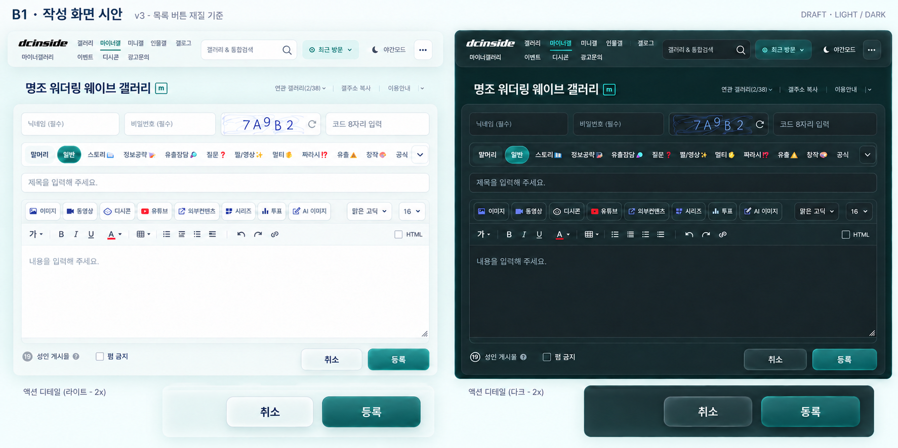

# B1 writer v3 — adopted list action material

Mode: Operate. Status: **IMPLEMENTED_SIMPLE_BUTTON_TREATMENT_ADOPTED**. The user adopted C885 buttons after rejecting higher-transparency trials.159FF759 preserves that appearance; v3 remains overall context. Form glass and unobserved popup interiors are separately scoped. See the current common-control receipt.

## Actual authority and changes

The user requested matching the existing list writing button, plus exterior/cancel/register glass without excessive transparency. Subsequent user clarification: the list itself can improve too; its button is a revisable working reference, not an immutable design authority. V3 records that refinement step, not a fixed final list specification. The current compact header remains the family anchor. Current list-presenter.js has the restrained36px face/40px hit area,8px radius, fine rim and bounded tone/shadow recorded in the prior button refinement; list cohesion preserved it. The actual list primary face is palette-based paint, not proof of backdrop transmission. Reuse its material cues honestly; real glass in the writer requires later implementation/render evidence.

- [Adopted list action, light](b1-adopted-list-action-light-2026-10-26.png), SHA-256 `0B64AC898EC9528C1B244282CA0775062163FDB70EE9D028BD79B826AA8310C6`.
- [Adopted list action, dark](b1-adopted-list-action-dark-2026-10-26.png), SHA-256 `BB3803D09F8CCAF44811C85229464BD4A8217FA973011526EE0F6C9A45638C8C`.
- Curated controls are from the actual8A5C button-refined captures; verification/receipts/2026-10-23-b1-button-reference-refinement.json records that runtime. B1_LIST_COHESION.md records its preservation and later user adoption. Current native list styling was inspected; no list code was changed for this proposal.

Draft SHA-256 `2A2D8A964F79D9DB5BC8127856206E3C74CA6E8731B841EABD72B1A785BE310E`. Built-in image_gen used the rejected v2 and actual light/dark button/toolbar references. Pass1 aligned actions and glass chrome; direct inspection found an overbright cyan rim, so pass2 reduced that glow. Exact [two prompts](b1-writer-material-v3-2026-10-26.prompt.txt) retained. Intermediate generated output is local only; the selected refined draft is tracked without overwriting v2.

Changes visible in v2/v3 comparison: large half-width gradient slabs become a compact right-aligned cancel/register group; primary teal retains weight with a finer rim/inner reflection and reduced glow. Cancel uses pearl/smoke glass cues. Exterior/action rail/tool chrome follow the current header family; editor body stays calm/opaque. The2x strips below are editorial detail views, not duplicate in-app actions. Keep native option semantics/warnings, labels, hidden fields and all tools even when raster details are imperfect. No new dropdown handler or upload/save feature is authorized.

Judgement: improved coherent proposal, **not accepted implementation or optical proof**. Main action color remains substantial; no near-clear/outline-only button was adopted. Generated icon/text/CAPTCHA remains illustrative. User preference and actual implemented transmission are pending separately. Preserve the original/native/published input roles documented in b1-write-current-theme-2026-10-25.md.

## External texture research — bounded reuse

- [CodePen original frosted-glass button demo](https://codepen.io/spajk23/pen/wvXzqQE): inspect thin edge/reflection/soft blur cues. Its very low-alpha fill, large pill, glow and hover letter-spacing are not adopted; no source code or external dependency is imported.
- [Arnold K. primary button example](https://dribbble.com/shots/26567499--Glowing-Action-Button-Assign-Role): depth/edge example only. Neon gradient/glow and near-clear material do not override the existing list style or user opacity constraint.

These are creator examples, not performance/usability evidence or a new global design system. The current list controls remain a concrete comparison; the coherent shared material and current user direction govern further refinements. Next: follow B1_CONTROL_MATERIAL.md and the exact selected writer image/hash/regions, then implement through the existing form owner and compare normal/backing light-dark renders plus affected native inputs/popups. Product CSS was not changed in this unit.
