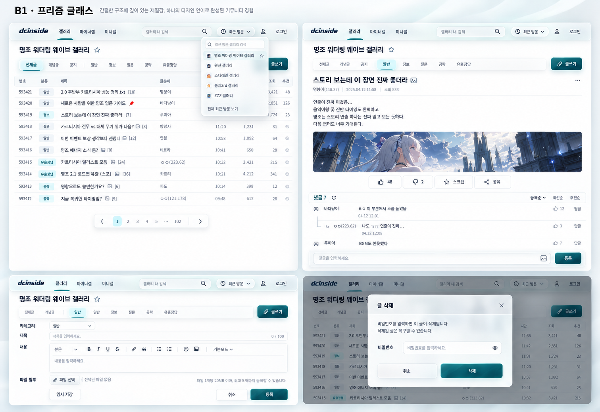

# UI design references for the next visual pass

Current material/selected ordinary-page reference: B1_GLASS_TRANSMISSION.md → CURRENT/NEXT. Older writer/dense-glass status language below is historical where superseded by the later user decisions.

Status: `B1_LIST_ADOPTED_AS_EXPANSION_BASELINE / EXPANSION_IN_PROGRESS`. CURRENT_STATE.md/NEXT_TASK.md own current progress and order; B1_UI_EXPANSION_PREFLIGHT.md owns the broad requested scope. The coherent B1 theme and current user direction govern the design; current header/list are revisable working references. The early raster supplies historical family direction. This reference page is not a completion receipt.

## Current choice: B composition + B1 Prism Glass

- **Selected by user:** B's compact header and anchored recent-visits menu, with B1's pearl/frosted-glass and restrained teal material feel. The runnable preview and8A button were approved; the finished native list at2dcd960/BCB96852 is now adopted as the expansion reference. Actual whole-UI appearance remains a separate review; the older receipt's pending preference describes its earlier recording time.
- **Early family reference (historical writer composition):** [B1 Prism Glass](../design/b1-prism-2026-10-22.png), SHA-256 `83D73F768193FC594536448500B7DC6671653CE1CDE498606698C2FF06CDF296`. Curated generated design reference tracked in Git, not a raw audit, release asset or product screenshot. Provenance: built-in `image_gen`, 2026-10-22, with the selected B board as composition reference; original generation remains preserved locally.
- **User's judgment retained:** B1/B2 largely changed material/color, not the underlying UI silhouette. B2 was overcolored and is **not adopted**. The previous large-title-card header was also visually rejected; its technical feasibility result does not approve its appearance. Do not revive either as an active design.
- **Common language:** compact quiet navigation, a frosted elevated recent/menu/control layer, gentle edge light, restrained primary/selected accents, clear opaque reading surfaces, and shared typography/spacing/radius/material roles across list, article/comments, write, settings and native/owned popups.
- **Limits:** choosing B1 adopts a trial direction, not every raster dimension, example control/text, duplicate tab, avatar or omitted input. Preserve the real checklist, native branding/nodes/events/forms, comment/reply/image-comment states, editor tools and existing palette IDs/settings. No new moderator/account capabilities or default-color change is implied. The board does not demonstrate substantial shape freedom, actual motion, dark mode, measured phone geometry, complete feature coverage or working UI.
- **Current sequence and write reference:** User steering2026-10-25 supersedes the early writer panel as the rigid composition target. Use the current adopted header's material/spacing, native real controls and published stable structure to make a tailored family proposal. The [writer v3](../design/b1-writer-material-v3-2026-10-26.md) refines the rejected v2 against actual adopted list action controls; it is DRAFT, user selection pending. Register/cancel/exterior must retain substantial tint and readable paper while showing controlled glass cues. Actual transmission remains an implementation check. Current selected masthead image: `docs/design/b1-current-header-2026-10-25.png`, SHA-256 `66C67E354401DD0719FDB1CBEC2409DBA09E9225F93551B674618971C8485248`, region y12–80; dark companion `docs/design/b1-current-header-dark-2026-10-25.png`, SHA-256 `A02AE414FE1F812AC19D5279D9F62F5709074A6914A7B4A98377F57F75640B09`. Current runtime remains NEEDS_WORK. UI_REFERENCE_GUARD.md still prevents silent reference substitution; authorized adaptation is allowed.
- **Research used:** [Raycast current UI](https://www.raycast.com/new) for layered compact controls; [Craft's 2025-09-15 glass update](https://www.craft.do/blog/craft-update-3-2-6) for selective material and cross-screen unity; [Things' official glass/control examples](https://culturedcode.com/things/blog/) for restrained light/scale feedback; [Apple material/motion principles](https://developer.apple.com/videos/play/wwdc2025/219/) for a distinct navigation/control layer; [Linear's 2026-03-12 refresh](https://linear.app/now/behind-the-latest-design-refresh) for hierarchy/compactness. These are references, not separately adopted skins or a promise of native optical refraction in a browser.
- Local comparison, optional: `artifacts/ui-overview-2026-10-17/b-glass-refinement-2026-10-22/index.html`. B2 stays an unadopted alternative; the tracked B1 image and this decision are the durable baseline.

## Current authority boundary — user clarification2026-10-26

The list UI/button is **not a canonical or immutable design authority**. It is a current comparison/example that can also improve when a more refined, coherent glass treatment fits. Develop the shared action material across writer and list together; retain adequate tint/readability rather than excessive transparency. Native/published stable controls remain behavior/coverage references. Frozen hashes identify the exact input being compared; they do not forbid an authorized design revision. User has now selected the restrained v3 material direction and instructed implementation across button families. Shapes remain per surface; implementation fidelity/user review is still separate. Selected image `docs/design/b1-writer-material-v3-2026-10-26.png`, SHA-256 `2A2D8A964F79D9DB5BC8127856206E3C74CA6E8731B841EABD72B1A785BE310E`; regions: writer chrome/actions and lower light/dark action-detail strips. B1_CONTROL_MATERIAL.md owns the bounded implementation plan. Adopt a coherent revised family before product-wide implementation; do not revive the rejected B2 palette or weaken native behavior to copy a raster.

## Tailored proposals for new UI families — D-53

1. Inspect the **current adopted theme/header**, **original native window** and **published stable UI**. Assign style authority to the current theme, structure/behavior to the real controls; keep native/fixture/generated provenance explicit.
2. For a new or materially different composition, make a separate proposal coherent with that current theme. An old sketch is directional history when it disagrees with the adopted UI. Reuse an adopted family proposal for equivalent menus/windows/states; no new image per button, theme or viewport.
3. Keep the proposal DRAFT until user selection. After selection bind its exact image/hash/region in NEXT and compare actual implementation through the existing guard/comparator. Keep source roles and important intentional differences; never make unfinished output its own golden or claim glass from a token alone.

This is a preparation/reference correction, not another test framework or approval ceremony. [Current writer v3 and inputs](../design/b1-writer-material-v3-2026-10-26.md) are the first use; no efficiency or universal aesthetic-detection claim follows.

## Historical Concept01 research — retained context

The following initial 2026-10-17 research/selection explains Concept01 and the original reference board. Historical prerequisites/next-step wording does not override CURRENT_STATE.md or NEXT_TASK.md.

## Selected Concept01 and execution boundary

- Local workspace copy: `artifacts/ui-overview-2026-10-17/design-references/dcuf-unified-concept-01.png`; SHA-256 `A2784372F5F0AD124BB1097096A97F5BBBACB13C6F26A1157C8FAD8E3A26B47A`. This is ignored review material, not a release asset. Preserve the original generated image; if the local copy is unavailable, recover the exact bytes from the saved conversation image and verify this digest. A missing image does not become visual approval of an arbitrary replacement.
- Provenance: built-in `image_gen`, requested by the user, generated 2026-10-17. The image shows four light-mode website panels in a2x2 board: list, article/comments, write form, management popup.
- Shared intent: neutral/off-white canvas, charcoal text, restrained teal emphasis, one Korean sans-serif hierarchy, common spacing, modest control/panel radii, thin borders, restrained shadows and consistent action states. These rules belong to one visual system across all four surfaces. Reference products contribute composition principles rather than separate skins.
- Planned use: `UI_REPLACEABILITY_VALIDATION.md` owns the actual implementation-and-measurement exercise after all prerequisites pass. Selection does not certify current code, extend publication authority, or bypass the remaining header/repair gates.
- The raster's example logo/art, sample text, control subset and dimensions are illustrative. Preserve native branding, all real features, forms/nodes/events, stored settings and measured viewport behavior. Define the dark counterpart through the same rules and validate it independently; the generated light board is not dark-mode evidence.
- Complete review scope is `UI_REVIEW_CHECKLIST.md`, not the four-panel sample. Every applicable native/owned popup, comment variant, editor menu, input state and status notification must be viewable as an indexed state in the existing comparison gallery before declaring the whole UI reviewed.

## Current visual judgment

In the corrected wide-layout screenshots, saturated blue fills the global navigation and repeats in the search border, gallery heading, categories, menu button, selected tabs and several secondary actions. This gives supporting controls too much weight. The dark management panel also contains several nested borders and repeated blue actions, while typography and spacing still change abruptly between host content and the new controls. Fixing the 15 defects is necessary, but does not by itself supply a clear new visual identity. These are design judgments, distinct from the diagnosed regressions.

## Four suitable references

| Reference and direct source | Useful part for DCUF | Adaptation and limits |
| --- | --- | --- |
| [Linear: March 2026 interface refresh](https://linear.app/now/behind-the-latest-design-refresh) | Low-chroma gray, subdued navigation, compact tabs and softer separation in a dense working interface. | Best overall reference for list/header hierarchy and dark mode. Preserve our native DCInside navigation; do not copy a desktop sidebar or tiny targets onto mobile. |
| [Readwise Reader: official product screenshots](https://readwise.io/read) and [appearance controls](https://docs.readwise.io/reader/docs/faqs/appearance) | A reading-first content area, quiet controls and typography settings for long text. | Best reference for article body and the central writing area. Retain author, comments, original editor tools, media and form behavior. An English product screenshot does not validate Korean type size/line height or our actual device layout. |
| [Radix Themes playground](https://www.radix-ui.com/themes/playground#button) and [color system](https://www.radix-ui.com/themes/docs/theme/color) | Teal accent with sage gray; solid/soft/outline/ghost action hierarchy, fields, tabs and dialogs in light/dark. | Best visual reference for settings/popups and replacing default-looking bright blue with a restrained accent. The local captures select teal/sage/medium radius using the official demo. Refer to visual roles only; no library installation or replacement of native nodes is needed. |
| [shadcn/ui Tasks: official example](https://ui.shadcn.com/examples/tasks) | Neutral list rows, subtle badges, compact filtering and a clearly stronger primary action. | Useful for block-management lists, search/filter controls and action menus. Keep forum rows readable at mobile scale; do not transplant desktop table columns, hover-only controls, or the marketing page. |

## Selected visual direction for the later trial

Combine Linear's quiet hierarchy with Readwise's reading emphasis. Use the Radix teal/sage direction for the default accent and controls; use the shadcn example to simplify settings lists. Treat this as one consistent visual language, not four unrelated skins.

- Use a neutral light canvas and a charcoal dark canvas, with strong body text. Restrict strong accent fill to the main action or selected state; secondary actions use neutral or low-chroma surfaces. Retain non-color state cues and visible focus.
- Choose row grouping, title/metadata hierarchy, line height, padding, icon treatment, border strength and modest radius together. Avoid a card around every nested control and a shadow around every row. Confirm actual Korean readability and touch geometry.
- Preserve all 14 palette IDs and stored settings. A future default-color change must be an explicit design decision, with corresponding contrast and theme checks; this reference brief changes no values.
- Show the implemented list, article, write and popup in light/dark using the same content and viewport. Concept01 establishes the selected trial direction; compare the actual coherent set and prove layout, interaction, compatibility and change locality through `UI_REPLACEABILITY_VALIDATION.md`.

## Source-image provenance

The local board at `artifacts/ui-overview-2026-10-17/design-references/index.html` is ignored review material. Its two embedded official source images are loaded from their original hosts:

- Linear article, linked “softer borders” comparison: `https://webassets.linear.app/images/ornj730p/production/67561baa677fbc429d94edd080e95aecabb6bae2-3904x2720.png?auto=format&dpr=2&q=95`
- Readwise Reader, linked inbox screenshot: `https://d34adp677peecb.cloudfront.net/static/images/reader/Hero-Screen%401x.72ad6bf1deaa.webp`

The Radix and shadcn images are browser screenshots of the above public official demos, taken on this review date. The original internet-reference board contains no AI images; the separately identified Concept01 is generated. No account content, copied product code, or external writes are part of this exploration. Reference images belong to their original creators and do not certify our product's appearance or behavior.

Final button decision2026-10-26: user rejected the higher-transparency trials and explicitly adopted the previous C885 simple button treatment. Keep dense primary tint, subdued edge sheen and per-surface shapes; the existing v3 image remains overall context, subordinate to this later preference for buttons. The high-transparency/scrim variants are discarded and must not be revived. C885 action captures and the tracked implemented light/dark samples identify the adopted look. Form/popup glass is a separate surface requirement.

P4 owned-panel draft2026-10-27: B1_OWNED_PANELS_PREFLIGHT.md selects docs/design/b1-owned-panels-target-light-2026-10-27.png (SHA256851D614864C50D62D8C6DF75CAB0E14C9082E84C48180BBA15A2E4BC9171AAF5) and its dark counterpart. Derived from current B1 theme, current actual owned templates and published anatomy; draft target for implementation, not approved runtime/golden. Existing C885 simple button choice remains unchanged.

User steering2026-10-27 supersedes dense/opaque ordinary-page glass: B1_GLASS_TRANSMISSION.md selects independent ordinary-page light target95B99AE7 and dark3B64E6B8 (full hashes in that decision) across existing B1 families. Modest visible contours through the real scrim are required; C885 simple button faces/paper remain. Old P4 target is anatomy context; above-scrim color probes only show optical capability. Same-area3× review is supporting evidence, not automatic aesthetic approval.

Current conditional refinement2026-10-28: B1_OWNED_CONDITIONAL_FINISH.md and docs/design/b1-owned-conditional-proposal-2026-10-28.css extend the adopted ordinary-page B1 family. Shared optional Mobile semantic ink/pending hooks preserve the common material and PC fallbacks. Independent2E99+recipe versus DC0B comparison covers16 selected pairs; no new world/button-transparency preference or all-child approval.

Owned input refinement2026-10-28: B1_OWNED_INPUT_CHILDREN.md + docs/design/b1-owned-input-proposal-2026-10-28.css extend the same95B99AE7 ordinary-page family. Optional explanation ink and one-line saved-rule/author actions preserve current glass,simple button faces and paper. Independent DC0B+recipe/current1593 has16 reviewed pairs; no new transparency or design-world decision.

Login preflight2026-10-28: B1_LOGIN_ENTRY_PREFLIGHT.md derives docs/design/b1-login-proposal-light-2026-10-28.png (0A3A0981) and its dark companion (2F4EDE28) from original sign anatomy,current B1 material and C885 simple buttons. Recipe is docs/design/b1-login-proposal-2026-10-28.css. Compact native header,glass exterior and opaque fields; no gallery navigation or invented authentication. These are provisional independent implementation-comparison targets,not implemented output or final user aesthetic adoption. Exact image hashes/region and source boundaries are in the brief and NEXT.
